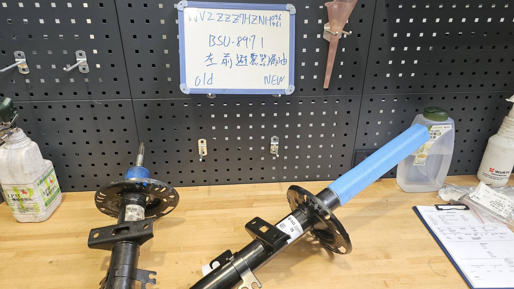
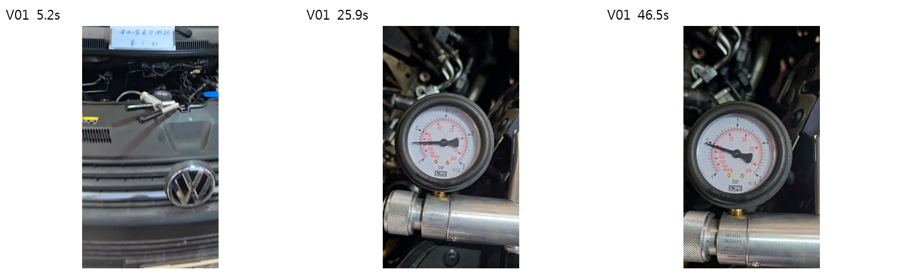
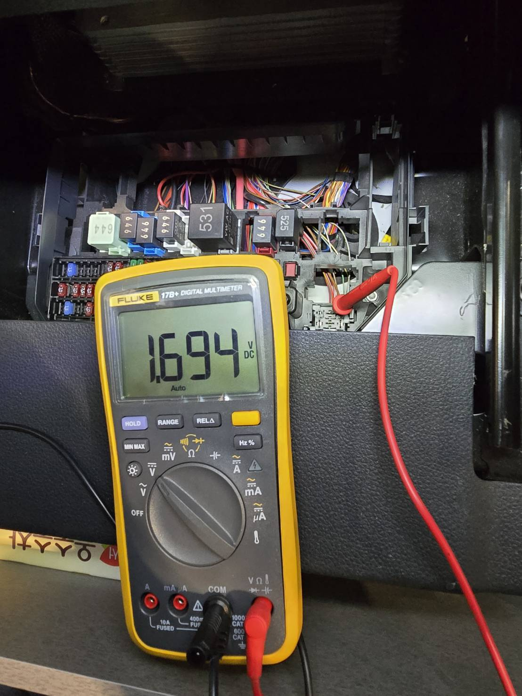
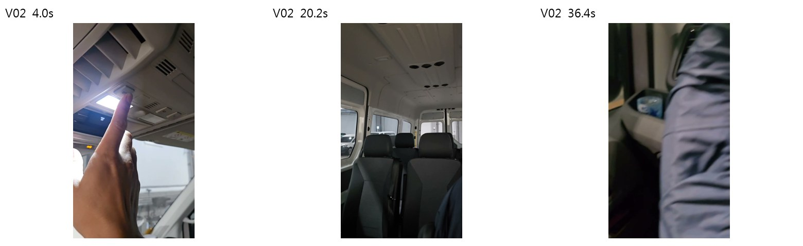
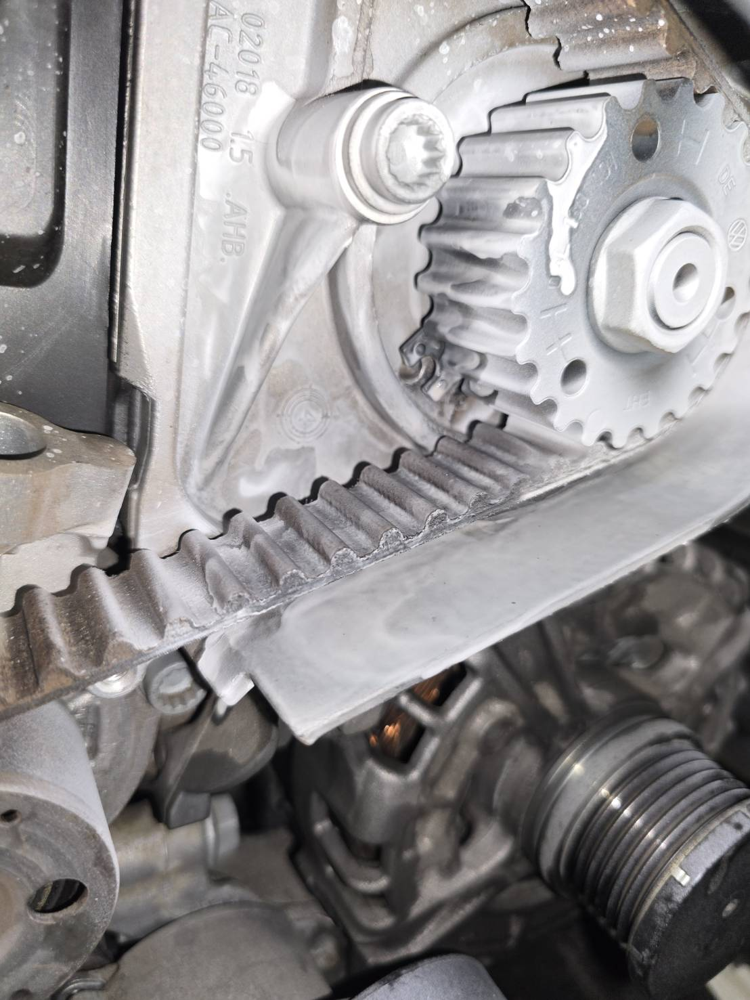
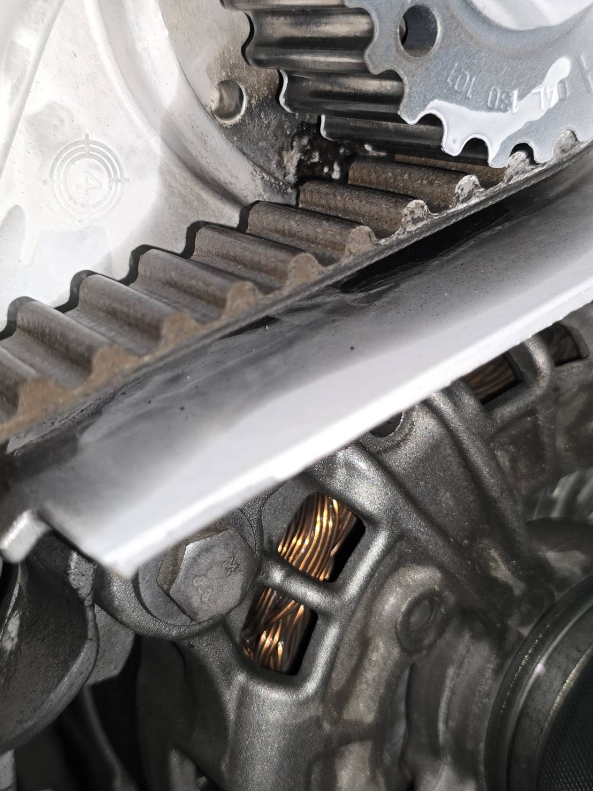

# 保固案件交接手冊

**版本：v0.1 初稿｜整理日期：2026-10-31｜用途：保固承辦交接、接手者訓練、特殊案件查詢**

原始資料位置：`E:\保固案件`  
內容確認人：＿＿＿＿　接手人：＿＿＿＿　主管：＿＿＿＿  
確認日期：＿＿＿＿　下一版維護人：＿＿＿＿

> 本版已將歷史案件轉成作業步驟與特殊案例。屬於「建議作法」的流程，仍須由原承辦確認為公司正式作法；系統入口、實際填報畫面、期限與核准權限尚待補齊。這些缺口集中列在第九章，可直接逐項回填。

## 如何使用這份手冊

| 現在遇到的事情 | 先看哪裡 |
| --- | --- |
| 第一次辦保固，不知道從哪開始 | 第一章、第二章，再依第三章逐步處理 |
| 不知道向技師要哪些資料 | 第四章「附件與影像檢查表」 |
| 有異常卻沒故障碼、TPI 條件不一致、需要回廠觀察 | 第六章特殊案例 C02、C03、C04 |
| 需要補件、零件保固、輪胎案件 | 第六章 C02、C06、C07 |
| 想直接複製表單開始工作 | 第七章「可複製範本」 |
| 想找原始案件、照片或影片 | [來源索引](來源索引.md)；依 S 編號查原始路徑 |
| 要把初稿變成正式交接版 | 第九章及[確認回填表](確認回填表.md) |

### 本文的三種標示

- **【紀錄】**：已讀到的故障敘述、表單、技術文件、圖片；若只有檔名或資料夾註記，會另行註明。
- **【建議】**：依現有資料整理的工作方法，供原承辦確認與採用。
- **【待確認 Qxx】**：現有資料不能確定的公司規則、案件結果或系統操作，對應第九章問題編號。

本文引用的是歷史版本文件。處理新案時，應查該車與該次維修適用的方案、技術資料及正式回覆。案例中的測試數值、料號、故障代碼與工時，不直接當成其他車輛的作業規格。

---

## 第一章｜先分清楚三件事

### 1.1 技術判斷、保固資格、申請結果要分開記

| 要回答的問題 | 主要依據 | 本文建議分工，待原承辦確認 |
| --- | --- | --- |
| 車輛哪裡故障？為何要修這個零件？ | 客訴重現、診斷、量測、維修手冊、適用 TPI | 技師診斷，技術主管確認疑難問題 |
| 這次維修可以走哪個申請類別？ | 車輛資料、方案、年限里程、零件更換紀錄、專案資格 | 保固承辦查核，疑義交主管或申請窗口確認 |
| 已經核准哪些項目、金額與條件？ | 申請平台狀態、正式回覆、核准編號 | 保固承辦留存，主管依權限確認 |

**故障成立，不代表所有方案都涵蓋；有 TPI，也不代表已取得費用核准。** 同樣地，資料夾裡有完工照、發票或名為「商譽」的 PDF，都不足以單獨判定核准或收款完成。

【紀錄】S01 的 `商譽.pdf` 可見車輛、損壞原因、里程等欄位，但該份輸出的授權號碼及確認區未見已填核准內容。它適合示範欄位查核，不能當成核准證明。

### 1.2 先辨識申請類別

| 候選類別 | 開始前先查什麼 | 現有資料能提供什麼 |
| --- | --- | --- |
| 原廠保固 | VIN、適用起算日、當次里程、故障項目與適用規定 | 有「原廠」案件資料夾，但仍需個案查核 |
| 延長／保險保固 | 方案名稱、涵蓋與除外項目、期限、申請窗口、是否需事前核准 | S01 報價單有保險保固及開票對象資訊；S08 有不涵蓋等名稱註記 |
| 零件保固 | 上次購買或安裝日期、里程、單據、料號，以及這次故障證據 | S02、S06 有自費更換紀錄或保固卡等資料 |
| 商譽申請 | 申請條件、分攤方式、授權人、正式回覆 | 多案有「商譽.pdf」，實際用途及申請方式待確認 |
| 專案 | VIN 適用資格、專案編號、措施與完成登錄 | S09 可見 69EJ 案件與相關附件 |

【待確認 Q01、Q02】以上是整理用分類，不代表已確認公司的全部申請管道；尤其「商譽」是否只是固定匯出表單名稱，須由原承辦說明。

### 1.3 建立一件案子的識別方式

【建議】以「工單號＋故障項目／子案號」辨識案件，車牌作查詢欄位。工單尚未開立時先用暫編號，開單後補上對應。

- 同一車牌不同故障分案記錄，避免把不同案件的照片與回覆混用。
- 同一工單有多項故障時，為每項標明佐證、報價與核准範圍。
- 系統、工單、報價、照片上的 VIN／車牌須對得上。
- 日期及里程保留「來源與量測時間」。不同進廠日期可能有不同里程，不直接把較新的數字覆蓋舊資料。

---

## 第二章｜一頁工作流程

```text
接到客訴／工單
  ↓
確認車輛身分、日期、里程與申請類別
  ├─ 資格、涵蓋或事前核准方式不明 → 查方案／詢問窗口，記錄回覆
  ↓
取得故障診斷與佐證
  ├─ 無故障碼 → 留存「無碼」結果，依症狀與技術資料補診斷
  ├─ 需清潔觀察／無法重現 → 建立觀察及回廠計畫，保留前後證據
  └─ TPI 條件不符／資料矛盾 → 交技術確認後再決定引用方式
  ↓
確認報價、申請範圍、附件與敘述一致
  ↓
依該類別規則，辦理事前申請及維修授權／施工／正式申報
  ↓
保存送件編號、版本與正式回覆
  ├─ 補件 → 逐條回應，留原版與補件版本
  └─ 不受理／範圍縮減 → 記原因、依據與後續處理，不只寫「不合格」
  ↓
補齊完工證據、核對請款與舊品處理
  ↓
依實際申請／收款狀態結案，將特殊經驗補入案例庫
```

**【待確認 Q03】正式送件、核准及施工的先後次序，可能隨申請類別不同。上圖不能用來推定所有案件都能先修後報。**

接手者每次至少留下五個結果：申請類別及依據、故障判斷及證據、送件版本、正式回覆、結案依據。

---

## 第三章｜逐步 SOP

### SOP 01｜接案與資格查核

**輸入：**客訴、工單、車輛基本資料。  
**建議執行人：**服務顧問提供接車資料，保固承辦查核申請路徑。

1. 記錄客戶反映的症狀、出現條件、首次發生時間與是否重複進廠。先保留原意，再由技師補診斷。
2. 核對車牌、VIN、工單號、車型、進廠日與當次里程，確認各份附件屬於同一件事。
3. 查詢車歷、適用方案及先前同零件更換紀錄；零件保固另查上次安裝日期、里程與單據。
4. 判定候選申請類別，保存查詢依據、查詢日期及版本。資料不明時，將具體問題交對應窗口。
5. 查該類別的事前核准、送件期限、可施工條件及費用確認流程。未明部分依 Q03、Q04 回填。

**完成條件：**案件識別資料完整，申請路徑有依據；尚未確定者明確標示「待資格確認」，並有詢問對象。

### SOP 02｜請技師提供故障診斷

**輸入：**症狀及候選申請類別。  
**輸出：**可讓未在現場的人理解的「症狀 → 檢查 → 結果 → 判斷」。

1. 請技師說明是否重現客訴，以及當時的冷／熱車、路況、操作或負載條件。
2. 留存診斷報告；有故障碼時記完整代碼、狀態、診斷位址及必要的症狀號碼。無碼也照實留存結果。
3. 記下所依據的檢測計畫、維修手冊章節或 TPI 編號與版本，請技師確認適用車型及條件。
4. 取得可支持判斷的量測或檢查資料：測點、數值、單位、測試條件與判斷依據。
5. 對照照片／影片，確認能看出部位、操作與結果；動態現象保留原影片。
6. 有內容不一致時先釐清。例如文字寫無故障碼，引用文件卻要求特定代碼，應回查原始報告。

**完成條件：**能回答「為什麼判定這個零件故障」，而且附件能支持敘述。承辦不自行補造技術判斷。

### SOP 03｜準備申請資料與報價

1. 依第四章建立本案附件清單，適用項目逐項確認；不適用者註明理由。
2. 依第七章範本寫故障敘述，將每個重要判斷對到檔名或報告。
3. 核對報價：故障部位、料號、數量、工時、外包項目與申請範圍是否一致。
4. 核對申請表欄位：車輛資料、日期里程、損壞位置、原因、故障／維修代碼等。代碼及工時依該案適用資料確認，不直接沿用舊案。
5. 零件保固另附上次更換證明；專案另附適用及完成所需資料；特殊項目另查專用表單。
6. 送出前，由承辦逐項勾選「身分一致、診斷一致、金額一致、附件可開」。

**完成條件：**申請內容、報價與佐證能互相對應，並已確認適用的施工授權程序。

【待確認 Q05、Q06】實際使用的申請系統、欄位、必傳附件、金額與主管覆核方式，需補操作畫面。

### SOP 04｜送件與留存回覆

1. 在該申請管道建立或開啟正確案件，避免同車不同工單誤掛。
2. 依欄位填寫資料，對照附件清單上傳；上傳後確認系統中能開啟或下載。
3. 記錄送件日期、申請編號、送件版本及附件清單。保存送出成功畫面或平台紀錄。
4. 將正式回覆存回本案，記下日期、回覆人／單位、核准範圍、金額或條件、待補項目及期限。
5. 口頭溝通後留下日期、對象與內容紀錄；如該管道要求書面確認，補存正式回覆。

**完成條件：**接手者能從案件編號找回「送了什麼」與「對方回了什麼」。

### SOP 05｜補件與特殊處理

1. 先存回覆原文，將要求拆成一項一項，勿只寫「補影片」。
2. 每項指定提供人與回覆日期；涉及診斷方式者交技師確認。
3. 補拍／補測時保留與原案的關聯：車輛、測試部位、日期、測試條件與結果。
4. 逐條寫「要求 → 回覆 → 對應附件」，新增版本資料夾，保留前一次送件內容。
5. 重新上傳後記送件時間，追蹤是否仍有疑義；沒有正式回覆前，不標記核准完成。
6. 特殊處理若含有個別授權、分攤或例外，將適用條件與授權紀錄補到案例卡。

**完成條件：**每項要求有回應、有附件、有結果；尚無法補齊者說明原因與下一個處理人。

### SOP 06｜完工資料、請款與結案

1. 在拆裝各階段收集拆前、拆下、新品、舊品、新舊對照、安裝與完工資料；依該案規則決定必備項目。
2. 請技師記錄修後驗證：原症狀是否消失、如何測試，以及必要的診斷或量測結果。
3. 核對最終清單、發票及申請／核准內容，確認開票對象、金額、項目與分攤；差異留下原因及確認紀錄。
4. 記錄舊品留存、退回或處理情況，並依公司及申請方規定辦理。實際期限與放行人依 Q07 回填。
5. 將「維修完成」「申請審核」「請款／入帳」分開記，依公司規則確認結案。
6. 如本案有補件或特殊判斷，新增或修訂案例卡，附原始證據及正式結果。

**完成條件：**各項狀態有對應證據。尚待請款或入帳者，仍保留對應追蹤事項。

---

## 第四章｜附件與影像檢查表

### 4.1 基本附件

【建議】下表是依現有案件建立的準備清單；各管道的正式必傳項目由 Q06 確認，不能視為所有案件一律必備。

| 項目 | 要確認的內容 | 缺少時向誰取得 |
| --- | --- | --- |
| 車輛身分與工單 | 車牌、VIN、工單號、日期相符 | 服務顧問／接車紀錄 |
| 里程紀錄 | 數值清楚，能對到本次進廠或查詢時間 | 服務顧問／技師 |
| 車歷、委託書 | 版本及本案關聯明確；缺車歷另註記 | 服務顧問／系統查詢人 |
| 車身方位照、VIN 照 | 依管道要求準備；現有資料常見正面及四角照 | 技師／接車人員 |
| 故障敘述 | 症狀、檢查、結果、判斷完整 | 技師提供技術內容，承辦整理 |
| 故障佐證 | 能看出部位、測試及結果 | 技師 |
| 診斷／TPI | 原始診斷資料、適用條件及文件版本 | 技師／技術主管 |
| 報價／清單 | 項目、料號、數量、工時、金額與範圍一致 | 服務顧問／零件／承辦 |
| 資格、申請及核准紀錄 | 方案或適用依據、送件編號、正式回覆 | 承辦／申請窗口 |
| 完工資料 | 新舊品、安裝與原症狀修後驗證 | 技師 |
| 發票及請款 | 開票對象、金額、分攤、請款及入帳狀態 | 出納／會計／承辦 |

### 4.2 拍攝時要回答的問題

| 拍攝內容 | 要讓審查者看懂什麼 | 本版案例 |
| --- | --- | --- |
| 部位全景＋異常近照 | 這是哪個零件、異常在哪裡；近照與全景有關聯 | C05 高壓泵漏油 |
| 清潔前後／再次出現 | 原始狀態、處置及後續變化，附日期里程 | C04 觀察後複檢 |
| 量測照片 | 儀表讀值、單位與測點；單張讀值不足時補測點說明 | C03 室內燈電系 |
| 動態故障影片 | 操作條件、動作過程與異常反應 | C02、C03 |
| 新舊品對照 | 同案的新舊零件、識別、位置及可核對標示 | C01 避震器 |
| 完工驗證 | 以能對照原故障的條件確認功能 | C02、C03 另有完工測試影片 |

【建議】拍攝前先確認「要證明什麼」。影片先交代車輛／案件及測試項目，保留足以理解的操作與結果；涉及持續時間的測試，原始連續影片應留存。若需壓縮，另存副本，送件後確認可播放且讀值仍清楚。

**本版影片僅抽樣畫格，沒有完整播放或聲音判讀；不能由抽樣畫格證明持壓時間、異音或整段功能結果。**

### 4.3 新舊品對照實例



【紀錄】P03 可見新舊避震器、案件識別板及 OLD／NEW 標示。這張適合說明「同案新舊品的關聯」；若審查需要清楚料號，仍須另補標籤近照，不能因為有新舊品合照就認定資料完整。[S01]

---

## 第五章｜檔案、版本與查找方式

### 5.1 原始案件先保留，新案採一致結構

【建議】不必全面搬動歷史檔案。先在案件索引登錄原始路徑；新案可使用下列結構，既有案缺少的核准、補件及結案紀錄再逐步補上。

```text
工單號_車牌_故障項目/
  00_案件摘要.md
  01_身分與資格/
  02_客訴與故障診斷/
  03_報價與申請/
  04_回覆與補件/
    2026-10-31_補件01/
  05_施工與完工/
  06_發票請款與結案/
```

命名示例：`Wxxxxxx_20261031_故障_左前避震器_清潔前_01.jpg`。數字及內容是格式示意，不是實際工單。已有工單號的原檔不必為了格式全部改名；以索引建立關聯即可。

### 5.2 上傳包與原始檔分開

【紀錄】部分檔名為 `.zip.txt`／`.7z.txt`。先前抽查的一個 `.zip.txt` 檔，其檔頭是 ZIP 格式；不能因此認定所有 TXT 都是壓縮檔。有些 TXT 是故障敘述，也有些是診斷匯出資料。

【建議】原檔保留；需要開啟或還原副檔名時先辨識格式，再對副本操作。原承辦應補充這種命名的用途、上傳規則、壓縮工具與大小限制。[Q08]

### 5.3 案件索引至少保留的欄位

`案件編號｜工單號｜車牌｜故障項目｜申請類別｜處理特色／關鍵字｜正式結果｜依據／回覆位置｜原始資料夾｜案例卡編號`

同車多案不要合成一列。搜尋時除了車牌，也應能用「無故障碼、回廠觀察、零件保固、補件、專案、方案不涵蓋」等情境找到案例。

---

## 第六章｜特殊案例與處理路徑

以下案例用來教「怎麼準備、如何查核、卡住時補什麼」。除非另附正式結果，本版均未確認最終核准、核付或收款。

### C01｜一般附件如何串成完整案件：左前避震器

**參考案件：**BSU-8971，左前避震器。[S01]  
**適用情境：**新人不知道一件保固案通常有哪些資料。

**【紀錄】**資料夾有車身方位、VIN、里程、車歷、委託書、報價、商譽表單、故障佐證、完工照及發票清單。已讀報價單顯示工單 W319383，且有保險保固、DISS 案件及開票對象相關資訊。這只代表文件內容，不代表已核准或已入帳。

**處理重點：**先核對同案關聯，再依序說明資格、診斷、申請、施工與請款；附件齊全度和案件結果分開記。

**特別查核：**商譽表里程與報價單里程不同，兩份文件日期也不同。回查儀表照與各文件時間，記錄差異來源，不直接認定錯誤或任意統一數字。

**待補：**核准回覆、實際送件平台與請款流程、最後結果。[Q02、Q05、Q10]

### C02｜沒有相關故障碼，還要補完整測試：噴油嘴

**參考案件：**BHV-9532，冷車啟動困難／噴油嘴零保。[S02]  
**適用情境：**無碼、冷車條件、曾自費更換、需分缸測試或補件。

**【紀錄】**故障敘述記載 ODIS 無相關故障碼，依 ELSA PRO 噴油嘴檢測進行測試，描述四缸均有洩漏現象。資料另有上次自費更換紀錄、TPI 2048217/13、回油量、分缸真空測試、燃油品質及補件影片；存在這些附件不等於已確認每項測試符合規格。

**建議處理路徑：**

1. 保留無碼診斷結果及可重現的冷車條件，不因沒有碼就自行結案。
2. 請技師說明採用的技術程序、適用車型、分缸結果及異常判準。
3. 零件保固另串起上次更換證明與本次故障；不要只附這次測試。
4. 本案補件資料可用來規劃錄影：案件與缸別識別、測試準備、儀表、連續過程及結果。實際拍攝要求仍以回覆原文為準。
5. 查到 TPI 時讀完整適用條件及處理路徑。該歷史 TPI 另涉及分段處理、回流量與燃油系統檢查，不能只摘「換噴油嘴」當通用作法。



**影片資訊：**原片約 51.7 秒；畫格取自約 5.2、25.9、46.5 秒。可見案件／缸別板與真空表，僅作拍攝組成示意，不能用三個畫格判定測試是否合格。

**待補：**補件要求原文、上次更換與本次申請如何連結、實際核准範圍及結果。[Q09、Q10]

### C03｜症狀相似，但文字與 TPI 條件有落差：室內燈

**參考案件：**BQG-7789，後室內燈無作用／J519。[S03]  
**適用情境：**引用 TPI、電壓量測、診斷敘述不一致。

**【紀錄】**故障敘述寫「無相關故障」，並記錄線路電阻、供電及 J519 至 J602 電壓檢查。量測照片 P04 可見 1.694 V 讀值。附上的 TPI 2068453/2，則將特定控制單元持續記錄 U110100 列為條件，其文件首頁也列有該事件。另一張診斷畫面可見 0009 有事件數量，但不足以獨立確認事件細節。

**建議處理路徑：**

1. 回查該次完整診斷報告，確認「無相關故障」的意思、檢測時間及是否有 U110100。
2. 請技師逐項對照 TPI 車型、症狀與代碼條件；有落差時記下原因，由技術主管／窗口確認適用性。
3. 將測點、單位、正常依據及照片對到故障敘述，不只貼一張儀表照。
4. 保存修後測試。本案有故障與完工功能影片，可供接手者對照；本版僅抽查故障影片畫格。



**教學重點：**照片能佐證當時讀值，但測點與正常範圍仍須技術依據。1.694 V 是本案紀錄，不是通用故障門檻。



**影片資訊：**原片約 40.4 秒；畫格約取自 4.0、20.2、36.4 秒。可見操作與車內環境；完整功能結果要回看原影片。

**待補：**診斷報告及文字差異原因、引用 TPI 的確認過程、實際結果。[Q11]

### C04｜要先清潔觀察，再回廠確認：漏油

**參考案件：**原廠 RFK-6276 左前避震器；RFT-6782 搖臂蓋墊片。[S04]  
**適用情境：**需要區分既有油污與持續洩漏，或首次檢查不足以確定。

**【紀錄】**原廠 RFK-6276 敘述記載先清洗並另約複檢，後續仍有漏油而申請保固。RFT-6782 有「2026.08.07 先清潔觀察」及「2026.08.11 清洗後 1000KM、相同位置漏油」的資料夾名稱，後者目前只作時間線索，未核定實際行駛里程或最終結果。

**建議處理路徑：**

1. 清潔前先留部位全景、近照、日期與里程。
2. 記錄誰決定觀察、清潔位置、觀察目的與回廠條件。
3. 回廠採相同部位與可比較角度拍照，記實際日期里程及是否再次出現。
4. 將兩次證據、技師結論及聯絡紀錄接成時間線，再依規則申請。

**不要直接套用：**「1000 公里」是歷史資料夾註記，不能當成所有漏油案件的固定等待標準。原廠目錄與根目錄另有同車牌 RFK-6276 案件，本版未確認是否為同次事件，不合併結果。

**待補：**觀察標準、回廠安排、適用技術資料及案件間關係。[Q12]

### C05｜異常位置不易看清楚：高壓泵漏油

**參考案件：**KKZ-8038，引擎室柴油味／高壓泵。[S05]  
**適用情境：**表面油污不足以說明來源，需要拆檢及處置前後證據。

**【紀錄】**故障敘述記錄由引擎室柴油味進行檢查，後續發現高壓泵軸心洩漏。附件中有清洗、顯影及其後狀態的照片。





**建議處理路徑：**請技師說明如何定位來源，將處置前後照片依序命名，另提供異常位置標示及技術判斷。P01、P02 可見相近部位的表面變化，但「洩漏來源」仍由技師診斷確認，不能只靠照片推定。

**待補：**該種檢查方式的適用依據、原始送件內容、審查是否要求補充及最終結果。[Q10]

### C06｜輪胎零件保固：專用表單與識別資料

**參考案件：**AVL-5761，右後輪漏氣。[S06]  
**適用情境：**輪胎、專用保固卡、購買／安裝紀錄及產品識別。

**【紀錄】**已讀輪胎保固申報表範本，內含購買與申請日期／里程、輪胎廠牌規格、胎紋深度等欄位；要求附保固卡、DOT／製造週期、損傷、10 碼條碼與中間剩餘溝深照片。該歷史表單另有另存 PDF、上傳 DISS 及檔名格式說明。

**建議處理路徑：**先確認目前適用的輪胎表單與受理管道，再收購買／安裝證明及保固卡；核對輪胎識別與測量照片；依表單排入資料，另存送件版並留存回覆。

**特別查核：**本案敘述同時提到內補、胎壁損傷與辦理保固。資料未提供足以確認受理依據的結果，不能寫成「輪胎受損都能保固」。該 sample 檔亦已填個案資料，重用時需清空後再填新案。

**待補：**本案受理原因、正式結果、現行表單及是否仍採相同送件／命名方式。[Q13]

### C07｜補件不只故障零件，也可能涉及耗材：節溫器

**參考案件：**BVY-0072，節溫器。[S07]  
**適用情境：**耗材用量、混合過程、分次補件。

**【紀錄】**已讀故障敘述；目錄另有供電、搭鐵、檢測計畫及冷卻液相關照片。`補件_20260320` 及 `補件2_20260408` 的檔名分別涉及混合前後、容器水位與加注後餘量。本版未逐張查驗這組水位照片，也未取得補件要求原文。

**建議處理路徑：**請原承辦還原「對方要查什麼 → 原本缺什麼 → 補什麼才足夠」。若本案需要證明用量，收集測量方式、容器刻度、起始及剩餘量、計算與對應報價；實際混合比例及用量由技術資料決定。

**不要直接套用：**檔名中的 4L、6L、10L、6.3L 只屬歷史附件線索，不作其他車輛冷卻液配比或容量指示。

**待補：**兩次補件要求、耗材佐證規則、是否與數量／工時有關及結果。[Q09]

### C08｜方案不涵蓋、超限、標記不合格：如何留下原因

**參考案件：**BMP-8693 排檔基座、BLH-6533 真空管、RAM-2922 方向主機、BSH-1352 大燈水氣等。[S08]  
**適用情境：**技術上有故障，但資格、承保範圍或佐證存在疑義。

**【紀錄】**資料夾分別註記「基礎型不涵蓋」「超過5年10萬」「不合格」等。BMP-8693 另附 TPI；RAM-2922 敘述有無碼及異音定位過程。這些資料可以支持建立問題類型，但不等於已取得正式拒絕原因或完整方案條款。

**建議處理路徑：**

1. 將「診斷結果」與「資格／受理結論」分兩欄。
2. 記錄實際方案、適用起算日及里程、故障項目、引用條款或正式回覆。
3. 「不合格」進一步說明屬於不涵蓋、超限、證據不足、條件不符或其他原因；未確認就寫待查。
4. 如需評估其他申請路徑，由有權窗口依規則確認，保留授權與客戶費用確認；不自行承諾一定可改走商譽。

**待補：**各案真正不受理原因、方案版本與最終處理，不以資料夾名稱當定案。[Q14]

### C09｜專案與零件改料：先確認適用，再留存處理證據

**參考案件：**8786-WQ，專案 69EJ-T8。[S09]  
**適用情境：**依專案措施處理、存在改料或特定零件識別。

**【紀錄】**目錄有多件 69EJ 案件；本案包含 `零件改料_佐證.jpg` 等附件。本版只確認檔名存在，未判讀該圖片，也未取得專案完整措施或系統完成紀錄。

**建議處理路徑：**先查 VIN 的適用與完成狀態，再依專案措施準備零件、施工及登錄資料。改料時留替代關係、使用零件與確認依據；不把不同 T8／T9／09／21 名稱視為相同內容。

**待補：**專案碼及尾碼意義、適用查詢方式、改料依據、完成登錄與申報方式。[Q15]

### C10｜相同車牌、相近症狀：只能借結構，不能照抄診斷

**參考案件：**RFB-6303，第二缸噴油嘴。[S10]  
**適用情境：**找舊案套用故障敘述。

**【紀錄】**本案敘述包含 P03A800、依 ELSA PRO 進行分缸測試及第二缸異常判斷；同車牌另有其他噴油嘴及引擎腳案件名稱。

**建議處理路徑：**可借用「症狀 → 檢測依據 → 實際測試 → 結果 → 判斷」結構；新案的缸別、代碼、測試值與零件需重新核對。依工單／時間辨識各次故障，不因車牌相同就連成同一原因。

**待補：**同車多案的時間與工單關係，以及本案實際結果。[Q10]

---

## 第七章｜可複製範本

### T01｜案件摘要

```text
案件編號／工單：
車牌／VIN：
故障項目與位置：
進廠日期／當次里程／資料來源：
客訴及發生條件：
申請類別／方案名稱與版本：
資格查核依據及日期：
技師／服務顧問／承辦：
診斷結論與證據：
引用手冊／TPI 編號、版本及適用核對：
是否需事前核准／依據：
送件平台／申請編號／版本／日期：
正式回覆位置／日期／核准範圍與條件：
維修狀態：
申請狀態：
請款／入帳狀態：
舊品位置／處理依據：
原始附件位置：
下一步／負責人／期限：
最後更新人／日期：
```

### T02｜故障敘述

```text
1. 客訴：客戶反映＿＿；發生條件為＿＿。
2. 重現：於＿＿條件下測試，結果＿＿。
3. 診斷：使用＿＿檢測，代碼／狀態為＿＿；如無相關故障碼則照實記載。
4. 依據：依＿＿手冊章節／TPI＿＿版本，已確認適用條件＿＿。
5. 檢查：測點／部位＿＿，條件＿＿，結果＿＿，判斷依據＿＿。
6. 結論：由＿＿判定＿＿，原因與上述證據的關聯為＿＿。
7. 處理：依適用程序辦理＿＿；修後於＿＿條件驗證，結果＿＿。
8. 附件：照片＿＿、影片＿＿、診斷報告＿＿。
```

送件時只填當時已完成的事。尚未施工或驗證的部分寫「預計／待完成」，不可預填正常。

### T03｜補件回覆表

| 序號 | 要求原文及回覆日期 | 要補的內容 | 提供人／期限 | 實際回覆及附件 | 補送日期／版本 | 結果 |
| --- | --- | --- | --- | --- | --- | --- |
| 1 | ＿＿ | ＿＿ | ＿＿ | ＿＿ | ＿＿ | ＿＿ |
| 2 | ＿＿ | ＿＿ | ＿＿ | ＿＿ | ＿＿ | ＿＿ |

### T04｜觀察與回廠紀錄

```text
第一次檢查日期／里程：
異常部位與原始照片：
診斷疑點及觀察目的：
清潔／處置內容、技師及依據：
約定回廠條件／日期／通知人：
回廠日期／實際里程：
相同位置對照照片：
觀察結果與技師判斷：
申請或其他處理方式／確認人：
```

### T05｜特殊案例卡

```text
標題／查詢關鍵字：
參考案件與原始附件位置：
適用情境／不適用條件：
遇到的問題：
查過的規則／文件版本：
詢問對象／日期／正式回覆位置：
處理過程與證據：
結果／核准範圍／未核准部分：
若涉及例外，授權人及適用條件：
下一位承辦可以沿用什麼：
仍須逐案確認什麼：
整理人／確認人／日期：
```

### T06｜送件前快速勾選

- [ ] 車牌、VIN、工單、部位與日期已核對。
- [ ] 申請類別、資格依據及事前核准要求已查清楚。
- [ ] 客訴、診斷、量測、結論與附件一致；差異已說明。
- [ ] 引用 TPI／手冊已核對版本及個案適用條件。
- [ ] 報價項目、料號、數量、工時與申請範圍一致。
- [ ] 本管道的必填欄位與必傳附件已確認。
- [ ] 照片清楚、影片可播放，動態／時間性證據保留原片。
- [ ] 送件版與原始檔均留存，補件要求逐項回覆。

---

## 第八章｜讓接手者實際做一次

【建議】用歷史案件副本演練，不必真的對外送件。原承辦觀察接手者能否只靠文件完成以下動作。

| 演練 | 接手者需交出的結果 | 通過條件 |
| --- | --- | --- |
| 標準案 C01 | 一份附件清單、案件摘要、尚缺資料列表 | 能找到原檔，區分文件存在與核准／入帳結果 |
| 無碼補件案 C02 | 診斷依據及逐條補件計畫 | 說得出要向技師拿什麼、測試影片要呈現什麼 |
| TPI 核對案 C03 | 條件對照與待釐清問題 | 能發現文字、診斷與文件條件需要核對 |
| 觀察案 C04 | 首次檢查到回廠的時間線 | 沒把歷史公里數當成通用門檻 |
| 專用表單案 C06 | 新案空白欄位與附件清單 | 沒沿用舊案個資或產品識別，知道查現行表單 |

演練時記下接手者每一次詢問。將答案補回「該步驟」或「該案例」，再由另一人重走，直到能獨立完成資料準備與問題升級。

---

## 第九章｜正式交接前要補齊的資訊

下列問題集中填寫於[確認回填表](確認回填表.md)，無須從頭重寫本手冊。

| 編號 | 要確認的內容 | 建議請誰提供 | 優先 |
| --- | --- | --- | --- |
| Q01 | 原廠、延長／保險、零件、商譽、專案如何分類，各自受理窗口 | 原承辦／主管 | 必補 |
| Q02 | 「商譽.pdf」實際用途，怎樣辨識正式核准、核准範圍與編號 | 原承辦 | 必補 |
| Q03 | 各類別申請、核准、施工及正式申報的順序和授權 | 原承辦／主管 | 必補 |
| Q04 | 申請、補件、請款期限與逾期處理；依據在哪裡 | 原承辦／窗口 | 必補 |
| Q05 | 實際系統入口、帳號權限、建立案件、欄位、送出、看回覆及結案畫面 | 原承辦，請截圖示範 | 必補 |
| Q06 | 各管道必填欄位、必傳附件、金額／工時覆核與確認人 | 原承辦／主管 | 必補 |
| Q07 | 舊品標示、放置、保留期限、退回／報廢與放行人 | 原承辦／零件／主管 | 必補 |
| Q08 | 壓縮檔加 TXT 的用途、上傳限制、工具與可接受格式 | 原承辦 | 必補 |
| Q09 | BHV-9532、BVY-0072 的補件要求原文、補件原因及最終結果 | 原承辦 | 必補 |
| Q10 | 各代表案例正式結果及回覆位置，請款／入帳確認方法 | 原承辦／會計 | 必補 |
| Q11 | BQG-7789 敘述與 TPI／診斷條件差異，實際如何確認及申請 | 原承辦／技師 | 必補 |
| Q12 | 漏油觀察的決定依據、回廠安排，RFK-6276 同車案件是否相連 | 原承辦／技師 | 補案例 |
| Q13 | AVL-5761 輪胎案受理依據、結果與現行表單／送件方式 | 原承辦 | 補案例 |
| Q14 | 不涵蓋、超限、不合格案件的正式原因、方案版本與後續處理 | 原承辦 | 補案例 |
| Q15 | 69EJ 等專案及尾碼意義、VIN 查詢、改料與完成登錄 | 原承辦／技術窗口 | 補案例 |

### 聯絡與權限表

| 事項 | 主窗口／分機或聯絡方式 | 備援 | 什麼情況找他 |
| --- | --- | --- | --- |
| 資格／申請疑義 | 待填 | 待填 | 方案、涵蓋、核准範圍 |
| 技術／TPI | 待填 | 待填 | 診斷、適用條件、補測 |
| 系統／帳號 | 待填 | 待填 | 開權限、系統異常 |
| 零件／舊品 | 待填 | 待填 | 料號、改料、留存退回 |
| 發票／請款／入帳 | 待填 | 待填 | 開票對象、差異、核銷 |
| 例外與費用授權 | 待填 | 待填 | 規則不明、特殊分攤 |

記錄系統入口與權限申請方式，不在手冊填私人密碼。

---

## 第十章｜版本與資料來源說明

### 本版做了什麼

- 讀取代表性故障敘述、輪胎申報範本、部分 TPI 與表單，將歷史資料轉成建議 SOP。
- 整理 10 個案例條目，標示已讀內容、僅有檔名的線索與仍待查核的結果。
- 選用 4 張照片；另抽取 2 支影片的各 3 個畫格作為教學示意，沒有完整播放或音訊判讀。
- 附上可複製表單、確認問題及來源索引，保留回查原始案件的路徑。

本版不是全資料逐檔審查，亦尚未由原承辦驗證系統操作。資料夾內容可能持續增加，因此不以初次掃描的檔案總數作為知識庫完整度證明。

### 建議修訂路徑

| 版本 | 工作 | 完成結果 |
| --- | --- | --- |
| v0.1 本版 | 由歷史案件建立骨架與案例，標出缺口 | 可閱讀、可逐項修正的初稿 |
| v0.2 | 原承辦回填 Q01-Q15，補實際畫面及核准／補件紀錄 | 公司作法、步驟與依據可核對 |
| v0.3 | 由沒辦過保固的人依第八章演練，再修文件 | 驗證新人能操作與提出正確問題 |
| v1.0 | 主管／原承辦確認，指定維護人，輸出 PDF | 正式交接版與可維護來源檔 |

**格式建議：Markdown 作為可修改的主檔；流程及案例確認後再產生 PDF。** 圖片用相對路徑放在 `assets`，與主檔一起保存即可。PDF 放教學畫面與影片路徑／時間點，原影片留在原始案件庫；PDF 本身不承載完整播放功能。

| 日期 | 版本 | 修訂內容 | 確認人 |
| --- | --- | --- | --- |
| 2026-10-31 | v0.1 | 建議 SOP、10 個案例、範本、待確認問題與來源索引 | 待原承辦確認 |

詳細來源及檢閱程度見[來源索引](來源索引.md)。
